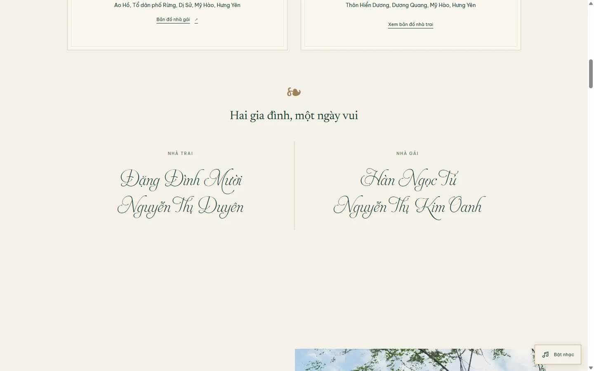
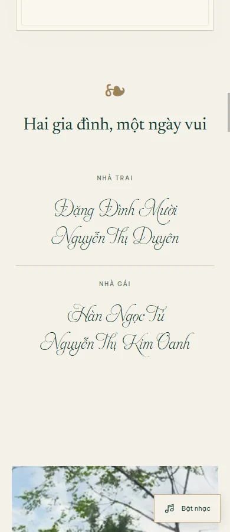

# Kiểm chứng Vườn Sương

Font tên đã đổi sang HLT AphroditeSlimPro đúng ảnh tham chiếu. Đã kiểm tra đủ glyph tiếng Việt cho sáu tên trong file font, rồi kiểm tra font thực sự được tải và áp dụng trong trình duyệt tại 320/375/390/768/1440px, 844×390 và 375×568. Tên không chồng nhau hoặc gây tràn ngang. Đã xem ảnh phong bì, hero và phụ huynh trên desktop/mobile; hai gia đình xếp dọc ở mobile để không phải co tên quá nhỏ.

Kết quả chi tiết: [verification-results.json](verification-results.json). **19 nhóm kiểm tra đạt**. Trình duyệt kiểm thử: Chromium trên Windows, 08/11/2026.

Ngày 23/11 hiện chỉ hiển thị nhà gái với link bản đồ tìm theo địa chỉ Ao Hồ; mục nhà trai trùng lặp đã được bỏ. Nhà trai ngày 24/11 và bản đồ Hiển Dương gần cuối trang được giữ nguyên. Bộ kiểm thử kiểm tra ngày 23 có đúng một link và không có mục nhà trai. Tiêu đề tab, Open Graph và Twitter cùng là “Quốc Hảo ❤️ Thùy Trang - Thiệp mời cưới”.

Kiểm thử các viewport 320, 375, 390, 768, 1440px, landscape 844×390 và màn hình thấp 375×568. Kiểm tra mở bằng bàn phím/chạm/chuột, không mở lặp, focus, tên tiếng Việt, dữ liệu cưới, ảnh thật, lightbox và không tràn ngang.

Nhạc không tải/phát trước thao tác mở; sau thao tác mở, file MP3 được giải mã và phát thật trong trình duyệt kiểm thử. Kiểm tra nút dừng/bật lại và nhánh trình duyệt chặn phát. Nhạc lỗi không ngăn mở thiệp. Các nhánh scroll/history vẫn gồm URL có fragment, reload từ cuối, Back và ảnh tải chậm.

Gacha hai bài: kiểm thử điều khiển kết quả ngẫu nhiên để buộc cả hai nhánh, xác nhận mỗi file đều giải mã/phát được. Không có `src` hoặc request MP3 trước khi mở, và chỉ file được chọn mới được tải. Sau khi tắt nhạc rồi đổi kết quả ngẫu nhiên giả lập và bật lại, bài vẫn không thay đổi. Mỗi lượt mở mới có thể bốc thăm lại; việc trùng bài ngẫu nhiên ở các lượt liên tiếp là hợp lệ.

Mục Nhà chú rể được kiểm tra nằm ngay trước cảnh cuối, bản đồ và chỉ đường cùng tọa độ. Không còn thành phần hồi đáp hoặc yêu cầu gửi thư. Nội dung lịch cưới kiểm tra địa điểm nhà gái mới và không còn các dòng giờ sẽ được cập nhật.

Chưa kiểm chứng Safari/iOS hoặc thiết bị thật. Các ảnh dưới đây được tạo lại từ bộ test; không phải kiểm thử gửi email.

## Desktop

## Mobile

## Tên phụ huynh — HLT AphroditeSlimPro

