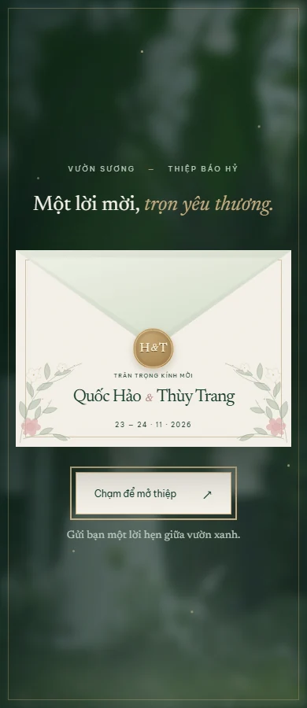
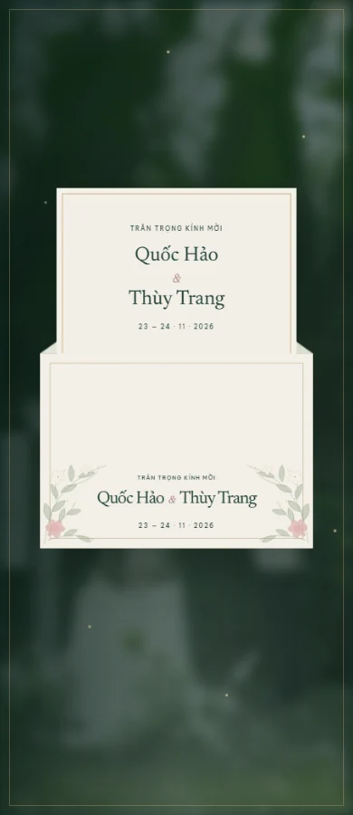
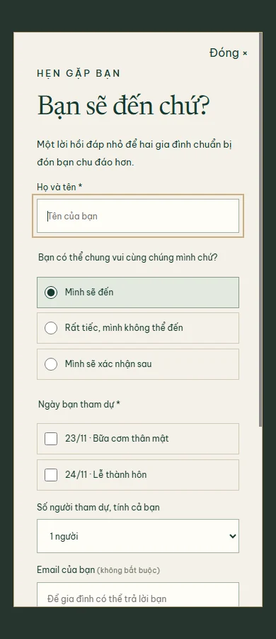
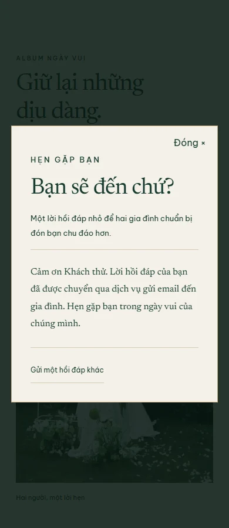
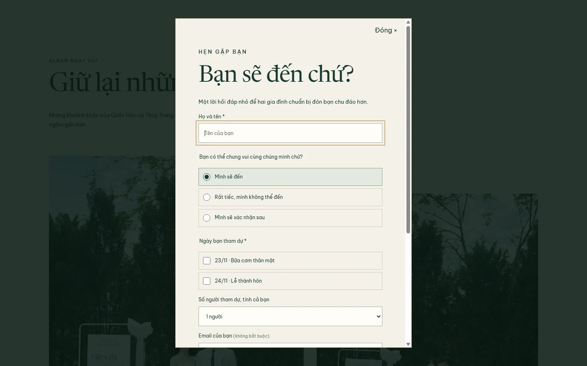
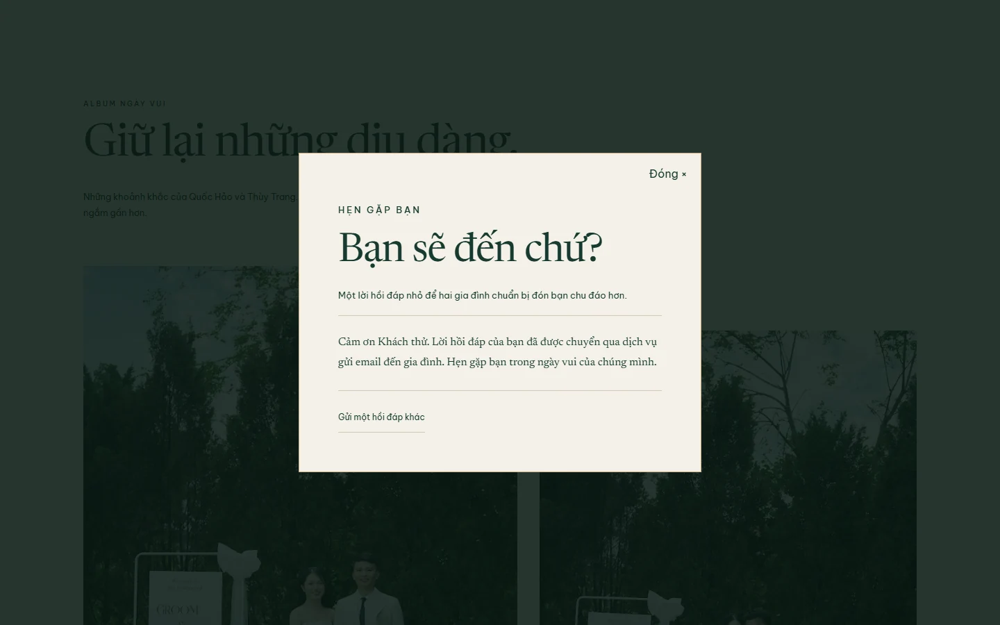

# Kiểm chứng Vườn Sương cinematic

Ngày kiểm tra: 08/11/2026. Trình duyệt: Chrome headless 156.0.8078.80 trên Windows. Kết quả máy đọc được: [verification-results.json](verification-results.json).

Lệnh chạy: `node verify-invitations.mjs`. **16 nhóm kiểm tra đạt**, không có lỗi console/runtime/asset nội bộ. Các request bị hủy do chuyển trang được phân biệt với asset thiếu. Ảnh minh chứng đã được cập nhật với 5 ảnh cưới thật gia đình cung cấp.

| Viewport   | Kết quả            |
| ---------- | ------------------ |
| 320 × 900  | Đạt, mở bằng Enter |
| 375 × 900  | Đạt, mở bằng Space |
| 390 × 900  | Đạt, mở bằng touch |
| 768 × 900  | Đạt                |
| 1440 × 900 | Đạt                |
| 844 × 390  | Đạt, landscape     |
| 375 × 568  | Đạt, màn hình thấp |

Ở mỗi viewport đã kiểm tra: focus ban đầu, giữ focus trong gate, nút mở nằm trong màn hình, phản hồi tức thì, chỉ mở một lần, hoàn tất khoảng 3 giây, xóa overlay, bỏ inert/khóa cuộn, không tự cuộn, tên không chồng lấn, font Việt tải được, không tràn ngang trước/sau mở, giữ toàn bộ thông tin cưới và âm lịch, không thêm giờ giả, Maps cùng tọa độ và không có transform ở phần tử cha, reveal khi cuộn, đủ 5 ảnh thật, hero dùng ảnh thật, ảnh không thiếu, lightbox Enter/←/→/ESC/nút đóng, trả focus, RSVP bắt buộc tên/ngày tham dự, loading/chống gửi hai lần/payload/thành công, reload quay về trạng thái hợp lệ.

**Kiểm thử gửi email dùng provider giả lập qua CDP**, chặn toàn bộ request FormSubmit. Không gửi thư thật trong suite. Các nhánh bổ sung: không tham dự gửi 0 người và ẩn chọn ngày, dịch vụ thất bại giữ dữ liệu và cho thử lại, email chưa kích hoạt không báo thành công, retry thành công và timeout báo chưa xác nhận được kết quả. Các screenshot trạng thái thành công dưới đây minh họa UI từ phản hồi giả lập, không phải chứng cứ email đã vào Inbox.

Các nhánh bổ sung đạt: đường dẫn cũ chuyển về trang chính, reduced motion mở tức thì, CSS animation bị hủy hoặc tắt vẫn giải phóng thiệp, runtime lỗi mở nội dung, thiếu IntersectionObserver vẫn hiện toàn bộ nội dung và JavaScript bị tắt vẫn đọc được thiệp.

Đã xem screenshot trên desktop/mobile, điều chỉnh hero mobile để tên không đè lên khuôn mặt và giữ ảnh album theo tỉ lệ dọc. Chưa kiểm chứng Safari/iOS, trình duyệt cũ, thiết bị thật, độ mượt/FPS trên điện thoại hoặc thao tác kéo/zoom trong Google Maps bằng thiết bị thật. Bản đồ đã được kiểm tra URL, kích thước và cấu trúc không chặn tương tác. Form đã kết nối endpoint email thật; kích hoạt và xác minh Inbox từ website thực tế là bước riêng, không được coi là đã đạt chỉ từ suite.

## Desktop

## Mobile

| Phong bì                                          | Đang mở                                          | Hero                                      |
| ------------------------------------------------- | ------------------------------------------------ | ----------------------------------------- |
|  |  |  |

## Hồi đáp

| Form mobile                                | Thành công mobile — phản hồi giả lập                        |
| ------------------------------------------ | ----------------------------------------------------------- |
|  |  |

Toàn bộ ảnh trong thiệp đã thay bằng ảnh cưới gia đình cung cấp. Ghi chú lời kể minh họa vẫn được giữ vì gia đình chưa xác nhận nội dung câu chuyện.
