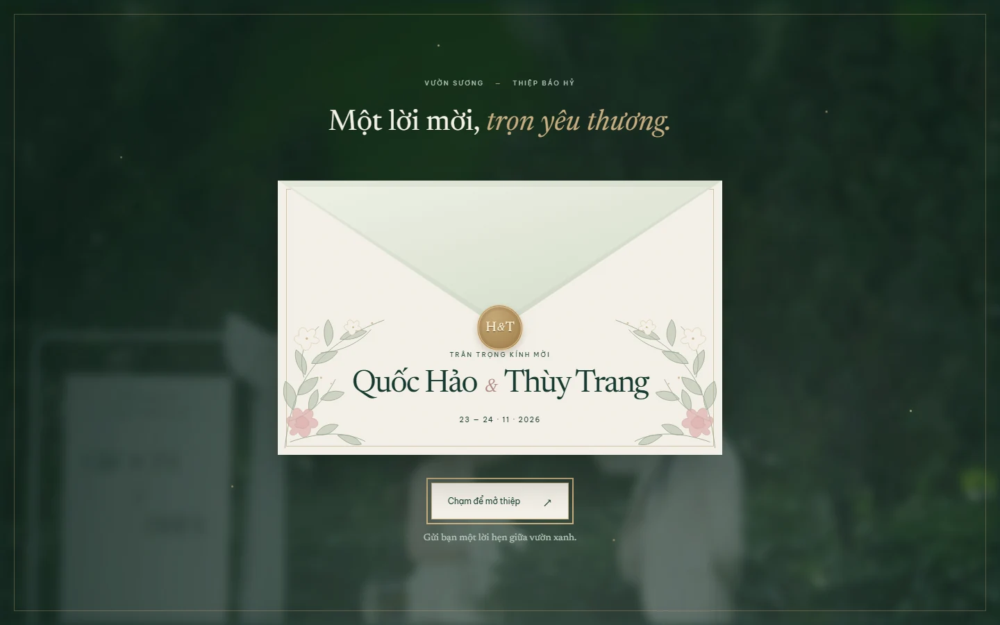
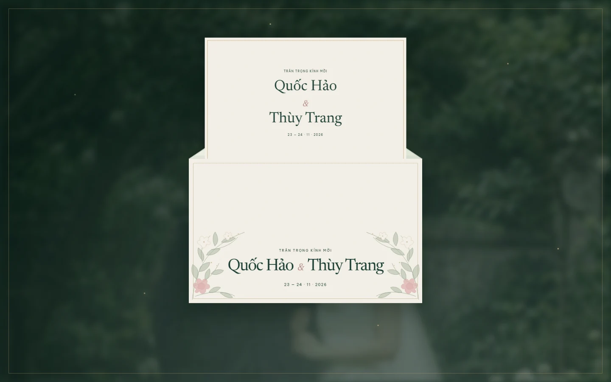
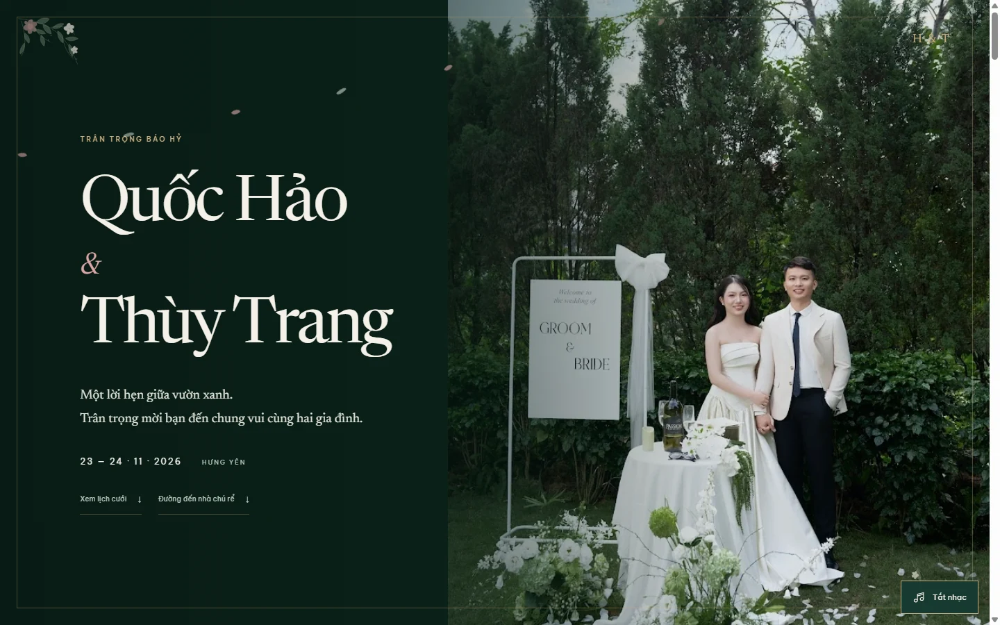
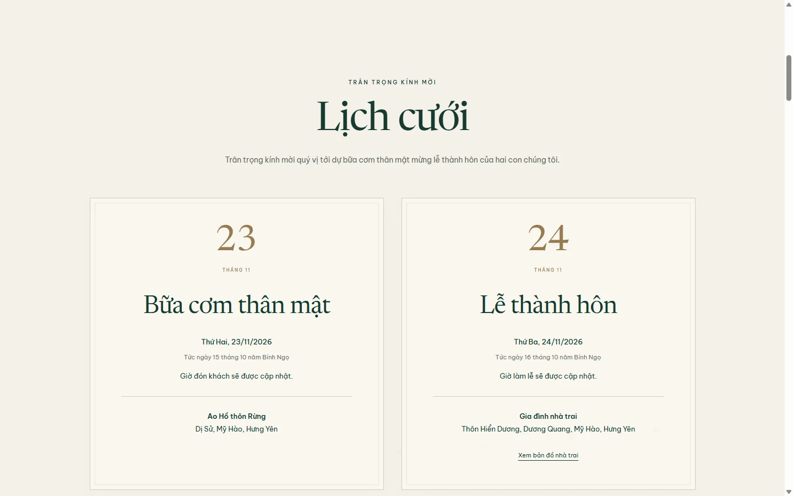
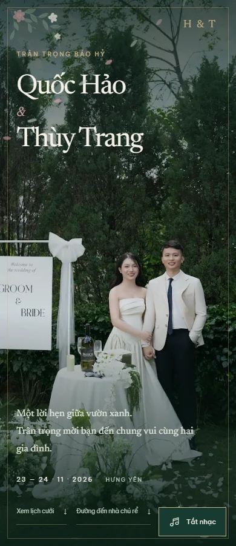

# Kiểm chứng Vườn Sương

Kết quả chi tiết: [verification-results.json](verification-results.json). **18 nhóm kiểm tra đạt**. Trình duyệt kiểm thử: Chromium trên Windows, 08/11/2026.

Kiểm thử các viewport 320, 375, 390, 768, 1440px, landscape 844×390 và màn hình thấp 375×568. Kiểm tra mở bằng bàn phím/chạm/chuột, không mở lặp, focus, tên tiếng Việt, dữ liệu cưới, ảnh thật, lightbox và không tràn ngang.

Nhạc không tải/phát trước thao tác mở; sau thao tác mở, file MP3 được giải mã và phát thật trong trình duyệt kiểm thử. Kiểm tra nút dừng/bật lại và nhánh trình duyệt chặn phát. Nhạc lỗi không ngăn mở thiệp. Các nhánh scroll/history vẫn gồm URL có fragment, reload từ cuối, Back và ảnh tải chậm.

Mục Nhà chú rể được kiểm tra nằm ngay trước cảnh cuối, bản đồ và chỉ đường cùng tọa độ. Không còn thành phần hồi đáp hoặc yêu cầu gửi thư. Nội dung lịch cưới kiểm tra địa điểm nhà gái mới và không còn các dòng giờ sẽ được cập nhật.

Chưa kiểm chứng Safari/iOS hoặc thiết bị thật. Các ảnh dưới đây được tạo lại từ bộ test; không phải kiểm thử gửi email.

## Desktop

## Mobile

